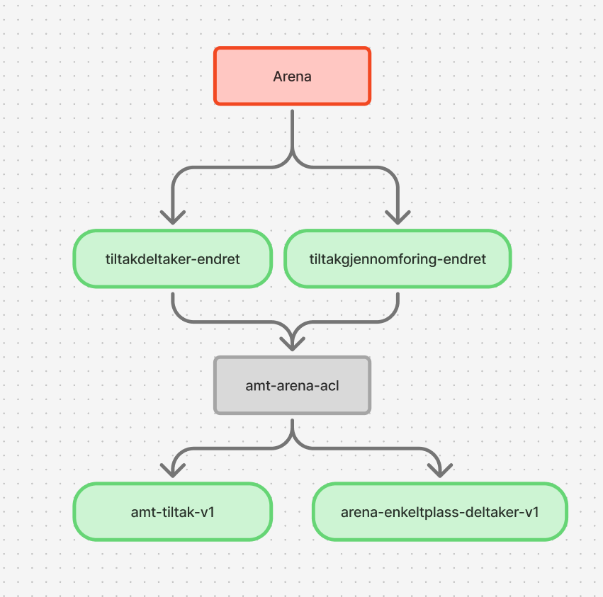

# amt-arena-acl

Leser data fra Arena og oversetter deltakere og gjennomføringer til AMT-domenet.

## Innhold

- [Kom i gang](#kom-i-gang)
- [Dataflyt](#dataflyt)
- [Historiske deltakere](#historiske-deltakere)
- [API](#api)
- [Drift](#drift)
- [Integrasjoner](#integrasjoner)
- [Deploy](#deploy)

## Kom i gang

Du trenger Java 25 og Docker. Start PostgreSQL og Kafka fra roten av `amt-stottetjenester`:

```bash
docker compose -f amt-arena-acl/docker-compose.yaml up -d
./gradlew :amt-arena-acl:check
```

Compose-filen starter de lokale avhengighetene som testene trenger. Repoet har ikke en ferdig dokumentert lokal
oppstart av hele applikasjonen med alle eksterne tjenester.

## Dataflyt

Applikasjonen leser deltakere, historiske deltakere og gjennomføringer fra Arena-topics. Originalmeldingene
lagres i `arena_data` sammen med ingeststatus. Tabellen `arena_data_id_translation` kobler Arena-ID til AMT-ID.



En deltaker kan først behandles når gjennomføringen finnes. Hvis gjennomføringen mangler, legger tjenesten
meldingen til retry. Jobber som bare kjører på leader-instansen:

- behandler retry-meldinger hvert tiende minutt
- behandler feilede meldinger ved midnatt
- sletter ignorerte data hver time

Gjennomføringens tiltakstype avgjør om Nav har hjemmel til å lagre deltakeren, og om deltakelsen kan sendes
videre.

## Historiske deltakere

En historisk deltaker oppstår når Arena historiserer en tidligere deltakelse for samme person og gjennomføring.
Koblingen mellom Arena-ID, historisk Arena-ID og AMT-ID ligger i `arena_data_hist_id_translation`.

Ved førstegangsinnlesing finnes det ofte ingen aktiv deltaker å koble historikken til. Da opprettes den
historiske deltakeren som en egen deltaker i AMT.

I løpende drift kan Arena først slette en aktiv deltaker, deretter publisere den som historisk med ny Arena-ID og
til slutt publisere en ny aktiv deltakelse. Tjenesten sammenligner dataene for å koble den historiske meldingen
til riktig AMT-deltaker. Delete-meldingen for den gamle aktive Arena-ID-en skal ikke slette AMT-deltakeren.

## API

| Metode | Endepunkt | Beskrivelse |
|--------|-----------|-------------|
| `GET` | `/api/translation/{id}` | Henter Arena-ID for en AMT-ID. |
| `GET` | `/api/v2/translation/{id}` | Henter aktiv eller historisk Arena-ID. |
| `POST` | `/internal/api/tombstone-enkeltplass-deltaker` | Oppretter tombstone for en enkeltplassdeltaker. |
| `POST` | `/internal/api/relast-deltakere/{tiltakskode}` | Laster deltakere på nytt for støttede tiltakskoder. |

De ordinære endepunktene krever Azure AD-token. Interne endepunkter er begrenset til interne kall.

## Drift

Se [driftsprosedyrene](docs/runbook.md) for å rekonstruere Kafka-meldinger. Prosedyren endrer ingeststatus og kan
republisere data.

## Integrasjoner

Applikasjonen bruker PostgreSQL, Kafka og Unleash. Den kaller `amt-arena-ords-proxy`, Mulighetsrommet API og
`amt-tiltak`.

## Deploy

GitHub Actions bygger og deployer endringer på `main` til `dev-gcp` og deretter `prod-gcp`.

- Nais-manifest: [`.nais/nais.yaml`](.nais/nais.yaml)
- Miljøvariabler: [`.nais/vars-dev.yaml`](.nais/vars-dev.yaml) og
  [`.nais/vars-prod.yaml`](.nais/vars-prod.yaml)
